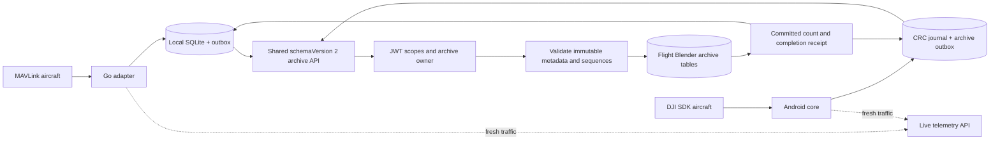

# Shared session archive API

The Go UTM adapter and DJI Android GCS use one vendor-neutral Flight Blender archive API. Its payload version is `session.schemaVersion: 2`. This is an OpenUTM application contract, not a new ASTM standard. Live traffic continues through `/flight_stream/set_telemetry`; its receipt window and processing acknowledgement do not establish durable historical storage.

## Deploy and use

Deploy Flight Blender's adapter router and apply `alembic upgrade head` (including `a218_session_records`) before upgrading clients. Configure the server base URL and a bearer identity with `flightblender.write` for uploads and `flightblender.read` for retrieval. Retain the same token issuer and subject when renewing credentials. HTTPS is required outside local development.

Go: start a flight session with its existing declaration, aircraft, operator and pilot. Local recording and automatic archive synchronization run independently of the live-delivery switches. End the session to publish its final count. Keep the application running or use Synchronize now until the archive is acknowledged. Local SQLite sequence numbers and exported reports remain version 1; the HTTP boundary converts samples to the common zero-based archive sequence.

DJI: import device setup, select the pilot and aircraft, plan and fly normally, then Finish (or Cancel before takeoff). Device journals retain samples during outages. Uploads continue after the operation closes, after the live receipt window expires, and after the app restarts. A closed operation with an outstanding archive displays an uploading status. Keep local records until archive completion; an operation being Ended does not itself acknowledge the archive. Battery changes within an unfinished flight keep the same archive. Starting another flight creates a new archive UUID.

DJI admins may explicitly provision `pilots` entries with `id`, `name`, and optional `license` and `contact`. For example, `{"id":"pilot-1","name":"Test Pilot","license":"TEST-123","contact":"pilot@example.test"}`. Only include personal information permitted by the operator's data-sharing agreement. Omitted fields remain absent/null, including for older journals; the clients never invent licence numbers or contacts. A stored archive with missing pilot metadata is not evidence that every operational or legal reporting requirement has been met.

## Request and receipt

`PUT /adapter_ops/sessions/{archiveUUID}` accepts at most 200 ordered samples. The path UUID must equal `session.id`; it identifies a recording, while `assignment.declarationID` identifies the existing declaration. Multiple recordings can reference one declaration.

```json
{
  "session": {
    "schemaVersion": 2,
    "id": "f1807e86-8faa-4801-b143-88c380f66648",
    "source": "dji",
    "sourceData": {"registrationID": "TEST-REG"},
    "assignment": {
      "declarationID": "4895d690-46d6-4d0d-9ceb-38f0dfc7c788",
      "vehicleID": "TEST-SERIAL",
      "operatorID": "TEST-OPERATOR",
      "pilot": {"id": "pilot-1", "name": "Test Pilot"}
    },
    "startedAt": "2026-10-25T10:00:00Z",
    "endedAt": "2026-10-25T10:00:01Z",
    "revision": 2,
    "finalSampleCount": 1
  },
  "samples": [{
    "sequence": 0,
    "recordedAt": "2026-10-25T10:00:00Z",
    "position": {"latitude": 47.5, "longitude": 19.0, "relativeAltitude": 30},
    "sourceData": {"gps": 5}
  }]
}
```

Common fields use degrees, metres, metres/second and UTC timestamps with offsets. Position requires latitude/longitude; optional fields are `relativeAltitude`, `altitudeWGS84`, `altitudeSource`, `altitudeSigma`, `velocityNorth`, `velocityEast`, `velocityDown`, `speed`, `heading`, `flying`, `motorsOn`, `satellites`. Unknown values remain absent/null. Heading is clockwise degrees in [0,360). Altitude WGS84 is ellipsoidal height, not MSL. DJI GPS signal level remains source evidence and is never treated as a MAVLink fix type.

`sourceData` preserves vendor-specific evidence without new endpoints. Go uses source `mavlink` and preserves the original Vehicle plus system ID, configured URLs and Aerobridge operation ID. DJI uses source `dji` and preserves TelemetrySample, including DJI GPS level, flight mode and available pilot coordinates. These source fields are evidence; they are not an authentication or hardware-attestation mechanism.

A successful PUT returns HTTP 200, after the database transaction commits:

```json
{"id":"f1807e86-8faa-4801-b143-88c380f66648","revision":2,"archive":{"receivedSampleCount":1,"finalSampleCount":1,"complete":true}}
```

While recording, send `endedAt: null`, `finalSampleCount: null`. Closing publishes both an end time and the final count, using a higher revision. An empty flight closes with count 0 and no samples. Completion requires precisely the unique sequences 0 through count−1. Samples may arrive in separate batches with gaps; the archive remains incomplete until every sequence is stored. Time must be within the session's start/end, independently of when the server receives it. The declaration must exist, but may already have ended or expired.

Assignments, source metadata, start time and sample contents are immutable. Reusing a sequence with different evidence is a conflict. Identical retries are accepted without duplicates. A stale metadata revision cannot reopen a closed session. Closed metadata cannot change apart from a revision increase carrying identical values. A final count cannot truncate samples already stored.

Persist the exact outbox payload before sending. Advance the archive cursor only after a valid receipt for this UUID; final acknowledgement must report completion and the expected count. Retain and replay the outbox when a response is lost, including across process restarts. Archive and live cursors must remain independent.

## Retrieval, failures and ownership

`GET /adapter_ops/sessions/{UUID}?after=-1&limit=200` returns `session`, `samples`, and `archive`. Continue with `after` equal to the last sequence received until a short page. The default cursor is −1 to include sequence 0. Each page is a current view, not a frozen snapshot of an active recording.

| Status | Meaning and recovery |
|---|---|
| 200, incomplete | Batch stored; upload remaining samples and closing metadata. |
| 401 / 403 | Check credentials/scopes; writes to another identity's archive are forbidden. |
| 404 | Archive unavailable to this identity, or endpoint missing on an old deployment. |
| 409 | Missing declaration, changed assignment/evidence, invalid closing bounds, or concurrent insert conflict. Retry identical payloads for concurrency; inspect persistent conflicts without discarding local data. |
| 422 | Invalid UUID, timestamps, values, sequence order or batch size. Correct the producer. |
| Network / 5xx | Keep outbox and retry with backoff. |

Archive ownership is the JWT `(iss, sub)` pair. Reads hide another owner's archive with 404; writes return 403. The declaration existence check does not prove ownership of the declaration: the declaration model currently has no matching authenticated owner field. Deployment access and credential provisioning must account for that limitation. Pilot attribution is separate from the device/service identity.

## Architecture and compatibility



Flight Blender keeps HTTP validation in `schemas/adapter.py`, transaction wiring in `api/routers/adapter_api.py`, service access in `services/adapter_svc.py` and persistence in `repositories/adapter_repo.py`. The router uses a function-scoped database dependency so commit failure cannot produce a successful receipt. Existing session/sample tables store the common JSON without vendor-specific columns; sample uniqueness is enforced by `(session_id, sequence)`.

The old Go wire payload remains accepted on this same endpoint for existing clients. An archive UUID cannot switch payload protocols: finish existing legacy server archives with the legacy client before upgrading. New Go and Android archives use version 2. Local Go reports and Aerobridge payloads keep their existing formats. Old Android journals remain readable; pending archives are reconstructed from their recorded metadata and available samples, with missing personal information left absent. There is no silent fallback from a failed archive upload to live telemetry.

## Validation and CI

Flight Blender: `uv run pytest tests/test_adapter_fastapi.py tests/test_import_architecture.py` covers scope enforcement, ownership, migration, both source types, deduplication, stale retries, bounds, gaps and final counts. The full Python suite remains applicable.

Go: `go test -race ./internal/...` includes multi-batch conversion across restart, exact retry bytes, and final receipt validation. Android: `./gradlew :core:test :adapter-fake:test` exercises journal recovery and expired-window archival without Android tooling. Android app assembly additionally needs JDK 17 and the Android SDK; the repository's existing Android CI builds the sim app.

Run both clients against the actual FastAPI application from the Go checkout:

```sh
FLIGHT_BLENDER_ROOT=../flight-blender \
DJI_ANDROID_ROOT=../dji-android-gcs \
scripts/test-flight-blender.sh
```

Install Flight Blender's locked dependencies first (`uv sync --locked`), put Go on PATH and configure JDK 17 in JAVA_HOME. The harness creates a temporary SQLite database, seeds an expired declaration, listens on an ephemeral loopback port, and removes it afterward. It runs real Go HTTP workflows and Android's `ArchiveContractIntegrationTest`. Android uploads over 400 historical samples, loses a response after server commit, reopens the journal, retries identical bytes, and verifies every sequence through paginated HTTP reads. It does not require Redis, Celery, a drone or credentials to external services. Its authentication bypass is confined to that temporary server.

The Go Tests workflow exposes manual Flight Blender and optional DJI ref inputs for companion branches until the server/client changes are merged. Supply both refs to run both clients. A missing or incompatible requested server/client fails the job; the Android contract test is skipped in ordinary JVM runs only when no integration harness URL was supplied. CI configuration and local tests do not constitute physical aircraft qualification or a published release.
